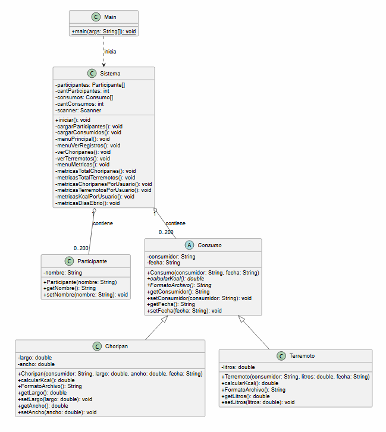

# Taller 2

## Integrantes

* **Nombre:** Guillermo Benjamín Torres Barrios
* **RUT:** 21.853.835-5
* **Carrera:** Ingeniería Civil en Computación e Informática (ICCI)
* **GitHub:** [guillermotorres01-wq](https://github.com/guillermotorres01-wq)

## ¿De qué trata el proyecto?

Al iniciar, el sistema lee los archivos `Participantes.txt` y `Consumido.txt`. Toda la información se guarda en arreglos estáticos de tamaño 200, validando las líneas vacías o posibles fallos para que el programa no se caiga al cargar los datos.

A través del menú en consola se pueden revisar las tablas con los consumos:
* **Choripanes:** muestra quién lo comió, sus medidas (largo y ancho), la fecha y el cálculo de calorías.
* **Terremotos:** muestra quién lo tomó, cuántos litros fueron, la fecha y sus calorías correspondientes.

### Uso de `abstract` y `extends`
Para aplicar bien los conceptos de POO pedidos en el taller:
* **Clase abstracta `Consumo`:** La definí como `abstract` porque representa una idea general y no un consumo específico. Contiene los datos comunes a cualquier registro (nombre del consumidor y fecha), además de dejar establecidos los métodos `calcularKcal()` y `FormatoArchivo()`.
* **Herencia con `extends` (`Choripan` y `Terremoto`):** Ambas clases heredan de `Consumo` con `extends` para reutilizar lo común y agregar lo suyo (medidas en el choripán y litros en el terremoto). Cada una resuelve su propio cálculo de calorías (`calcularKcal`) según la fórmula indicada.

---

## Estructura del Proyecto

* `src/taller02/`
  * `Main.java`: clase principal que arranca la aplicación.
  * `Sistema.java`: administra los arreglos, la lectura de archivos y la navegación por los menús.
  * `Participante.java`: modelo para representar a cada asistente.
  * `Consumo.java`: clase base abstracta de los consumos.
  * `Choripan.java`: clase hija para los registros de choripanes.
  * `Terremoto.java`: clase hija para los registros de terremotos.
* `Consumido.txt` y `Participantes.txt`: archivos con los datos iniciales.
* `diagrama_uml.png`: imagen del diagrama de clases.
* `Diagrama_Clases.pdf`: archivo PDF con el diagrama solicitado para la entrega.

---

## Diagrama de Clases UML

*(El diagrama también está disponible en la raíz del proyecto como `Diagrama_Clases.pdf`)*.

---

## Cómo ejecutarlo

## Repositorio:
   https://github.com/guillermotorres01-wq/Taller_2.git
